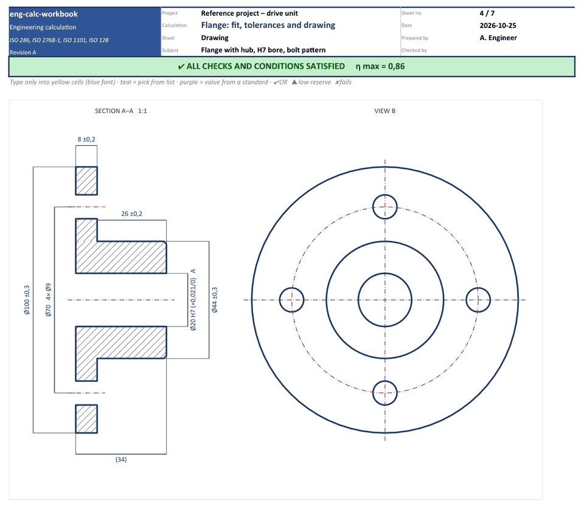
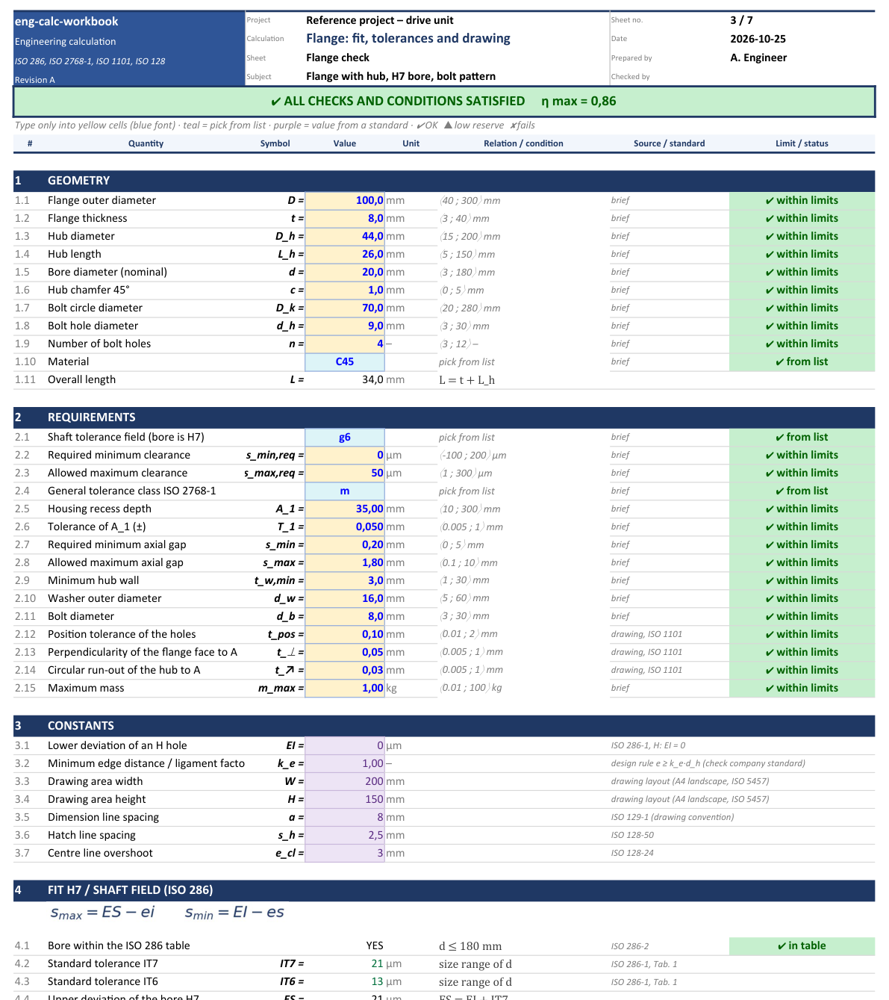
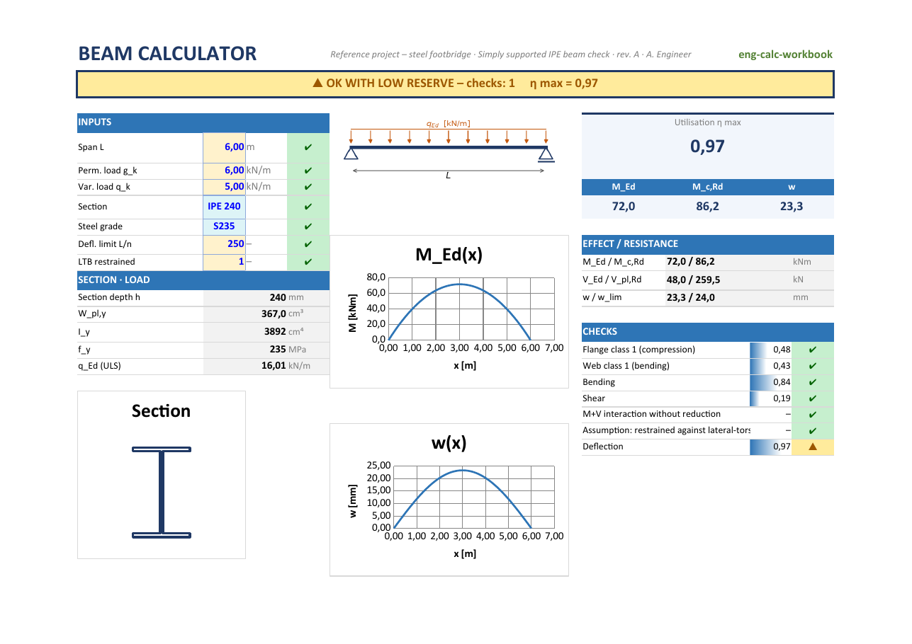
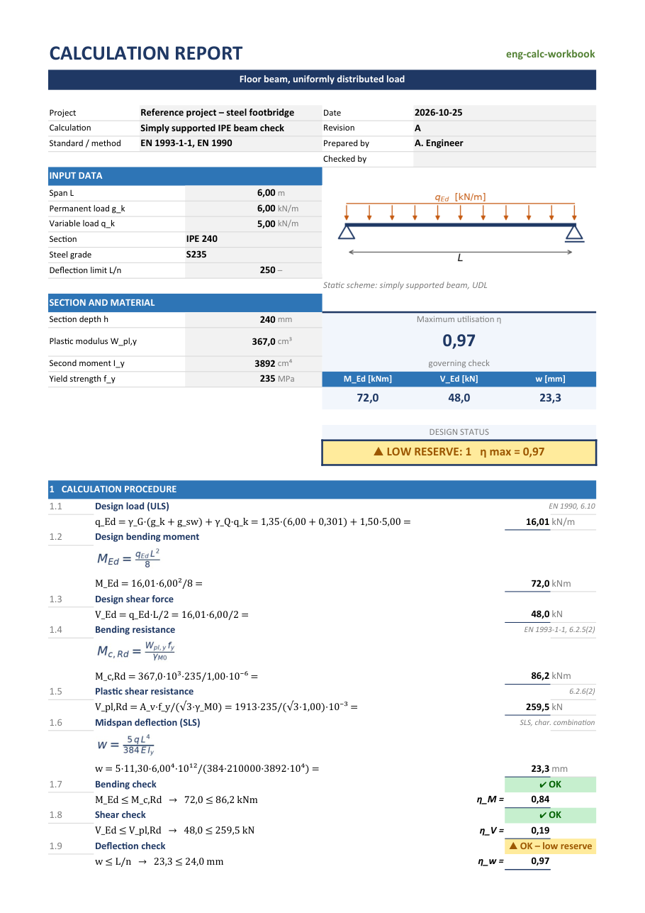
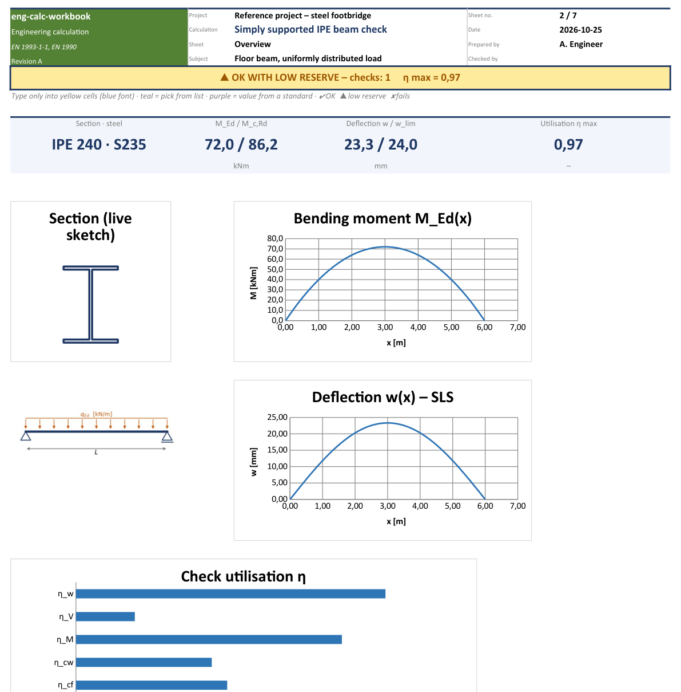
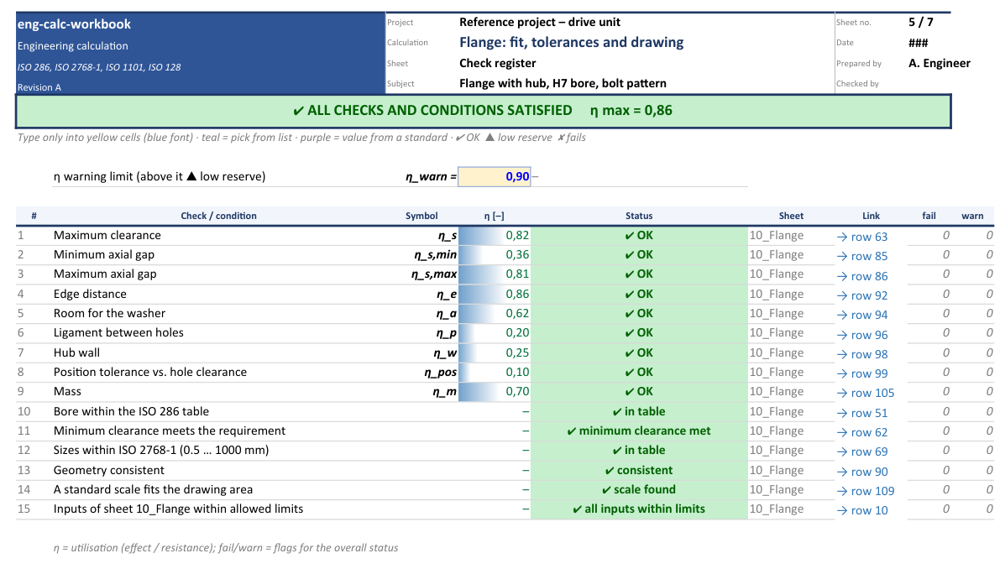
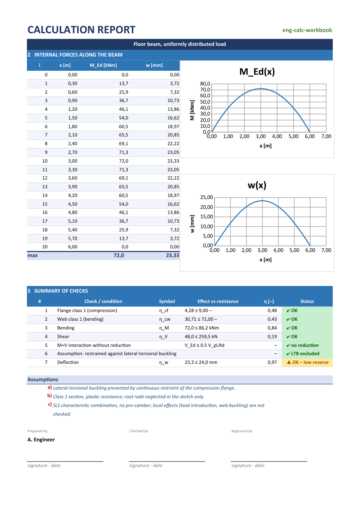

<div align="center">

# ENG-CALC

### Describe a calculation in one sentence. Get an Excel workbook an engineer would sign.

An open skill for Claude that turns plain requests into **verified, traceable, good-looking**
engineering spreadsheets — with live drawings, automatic pass / fail checks and a printable report.

[](https://github.com/Jinksen/eng-calc-skill/actions/workflows/verify.yml)
[](https://github.com/Jinksen/eng-calc-skill/releases/latest)




<sub>Change a number — the drawing, dimensions, scale, checks and status banner follow. No macros, just formulas.</sub>

</div>

---

## Why this exists

Half of the world's engineering runs on spreadsheets. Most of them are a mystery a year later:
numbers typed into formulas, no units, no sources, no idea whether the result is still valid.

**eng-calc-workbook teaches Claude to build them the way a careful engineer would** — every
input checked, every value sourced, every limit visible — so that anyone can open the file,
see a green or red banner, and trust it.

## What you get

<table>
<tr>
<td width="33%" valign="top">

### ✅ Checks you can see
Every requirement becomes a check with a utilisation and a clear **✔ / ▲ / ✘**. One banner at
the top tells you if the design passes.

</td>
<td width="33%" valign="top">

### ✏️ Drawings that update
Parts, sections and sketches are drawn **inside Excel** and redraw when you change a dimension
— with tolerances, hatching and a title block.

</td>
<td width="33%" valign="top">

### 🖨️ Reports ready to hand in
A printable report that reads like a hand calculation: formula, substituted values, result,
summary of checks, signatures.

</td>
</tr>
<tr>
<td valign="top">

### 🛡️ Mistakes caught early
Inputs out of range, missing sources, hard-coded numbers and broken formulas are flagged
automatically — before anyone relies on the result.

</td>
<td valign="top">

### 🧭 Fully traceable
Every check tied to a requirement, every standard with its edition and national annex, named
quantities instead of cell addresses, assumptions that keep the banner amber until confirmed.

</td>
<td valign="top">

### 🔌 Works where you work
Live in **Claude in Excel**, as a generated file in **claude.ai** or **Claude Code**, and the
files open in **LibreOffice** too.

</td>
</tr>
</table>

## See it

<table>
<tr>
<td width="50%"><br><sub><b>Live part drawing</b> — section, view, dimensions with tolerances, automatic scale</sub></td>
<td width="50%"><br><sub><b>Calculation sheet</b> — guarded inputs, sourced constants, every step with its formula</sub></td>
</tr>
<tr>
<td colspan="2"><br><sub><b>One-screen calculator</b> (layout S) — inputs with ✔/✘, sketch, M(x) and w(x), key result, η with data bars and the live banner on one page; a wrong value shows its consequence at once. The skill lets you pick the layout: S, mosaic of pages, compact check sheet, variants, calc pad or report</sub></td>
</tr>
<tr>
<td><br><sub><b>Printable report</b> — reads like a hand calculation, ready to attach to a technical report</sub></td>
<td><br><sub><b>Overview</b> — key numbers, live sketch, diagrams and how close each check is to its limit</sub></td>
</tr>
<tr>
<td><br><sub><b>Check register</b> — every condition in one place, linked back to its row</sub></td>
<td><br><sub><b>Report, page 2</b> — tables, charts, summary of checks, assumptions, signatures</sub></td>
</tr>
</table>

## Try it in a minute

**1. Install**

- **claude.ai / Claude in Excel** — download `eng-calc-workbook.zip` from the
  [latest release](https://github.com/Jinksen/eng-calc-skill/releases/latest) and upload it in
  *Settings → Capabilities → Skills*. The release also has ready-built sample workbooks to open
  right away.
- **Claude Code**
  ```
  /plugin marketplace add Jinksen/eng-calc-skill
  /plugin install eng-calc-workbook@eng-calc-workbook
  ```

**2. Ask**

> *Build a check of a steel beam for a 6 m span.*
> *Size the cable for a 22 kW motor 80 m from the switchboard.*
> *Draw this flange with tolerances and check the bolt pattern.*
> *Make a test report for these measurements with a pass / fail summary.*
> *Review this workbook and tell me what is wrong with it.*

**3. Get a workbook** — Claude first agrees the specification with you, then builds the
file, verifies it and tells you how it double-checked the result.

## It asks before it builds

A spreadsheet can be internally consistent and still wrong. Before the first cell, Claude
agrees the things an engineer would ask a colleague, in a few grouped questions with
sensible defaults:

| | Asked | Shows up in the workbook as |
|---|---|---|
| 🎯 | **Requirements** and who sets them (standard, contract, client spec) | an ID on every check; a requirement without a check turns the banner red |
| 📚 | **Standards** with edition, national annex and options chosen | a normative basis table; national parameters as sourced constants |
| 🛡️ | **Safety concept** — partial factors, safety factor, derating or acceptance criterion | each factor applied once, visible in the formula |
| 🔀 | **Cases** — load cases, operating states, scenarios | one column per case, the worst case found by formula |
| 🧭 | **Conventions** — axes, positive directions, reference system | a conventions section and axis arrows on the sketch |
| ❓ | **How sure each input is** — confirmed, measured, assumed | an assumption register; amber banner and *PRELIMINARY* until confirmed |
| 📏 | **Tolerances and measurements** | unfavourable bounds as extra cases; pass / fail with measurement uncertainty |

Whatever you cannot answer yet is recorded as an assumption to confirm, never quietly
guessed. Details in [`specification.md`](skills/eng-calc-workbook/reference/specification.md).

## Built for

| | |
|---|---|
| ⚡ **Electrical** | cables, protection, short circuits, machines, transformers, phasors |
| ⚙️ **Mechanical** | shafts, bolts, welds, bearings, fits and tolerances, part drawings |
| 🏗️ **Civil** | beams, sections, slabs, trusses, load combinations |
| 🧪 **Test & lab** | measurement reports, statistics, regression, pass / fail limits |

…and anything else where a spreadsheet has to be **right** and **explainable**.

## How it works


The skill is a set of instructions plus a small Python library. It encodes one consistent
visual language, a standard workbook structure and a verification step — so every workbook,
from every user, looks and behaves the same.

<details>
<summary><b>For developers — library, reference builds, repository layout</b></summary>

### Build the examples

```bash
pip install openpyxl pillow matplotlib          # + LibreOffice and poppler-utils for verify
python skills/eng-calc-workbook/scripts/example_flange.py out/example_flange.xlsx
python skills/eng-calc-workbook/scripts/example_ipe_beam.py out/example_ipe_beam.xlsx
python skills/eng-calc-workbook/scripts/example_ipe_beam.py out/beam_calculator.xlsx --screen
python skills/eng-calc-workbook/scripts/verify.py out/example_flange.xlsx --render out/render
```

### The library in a nutshell

```python
import datetime as dt
from engcalc import EngWorkbook, Meta, Col, index_match

book = EngWorkbook(Meta(project="Drive unit", title="Shaft check", subject="Output shaft",
                        author="A. Engineer", date=dt.date.today(), domain="mechanical"))

db = book.data_sheet("90_Database", "Materials", "Material catalogue")
db.table("mat", [Col("key", "Material"), Col("Re", "Re [MPa]", "0")],
         [("C45", 430), ("42CrMo4", 650)], source="EN 10083-2, Tab. 4")
db.close()

s = book.calc_sheet("10_Shaft", "Shaft check", "Inputs, stress, check")
s.section("Inputs")
s.input("in_T", "Torque", "T", 250, "Nm", lo=1, hi=5000)
s.input("in_d", "Diameter", "d", 30, "mm", lo=10, hi=200)
s.input("in_mat", "Material", "", "C45", "", choices="lst_mat")
s.section("Check")
s.calc("calc_tau", "Torsional stress", "τ", "16*in_T*1000/(PI()*in_d^3)", "MPa", text="τ = 16 T / (π d³)")
s.calc("calc_Re", "Yield strength", "R_e", index_match("mat", "Re", "in_mat"), "MPa", fmt="0")
s.check("chk_tau", "Torsion", "η_τ", "calc_tau", "calc_Re/SQRT(3)/2", "MPa", source="safety 2 on τ_y")
s.close()

book.readme(purpose="…", scope=["…"], assumptions=["…"], workflow=["…"], sources=["…"], revisions=[])
book.save("out/shaft.xlsx")        # register, banner, legend, README, protection — automatic
```

Also included: a drawing toolkit (`drawing_chart`, live hatching, GD&T frames, title blocks),
a printable report sheet, and `verify.py` (LibreOffice recalculation, lint, PDF / PNG render).
Full API in [`python-engcalc.md`](skills/eng-calc-workbook/reference/python-engcalc.md).

### Reference builds

| Build | Shows |
|---|---|
| [`example_flange.py`](skills/eng-calc-workbook/scripts/example_flange.py) | part with fits and tolerances, live drawing, GD&T, title block |
| [`example_ipe_beam.py`](skills/eng-calc-workbook/scripts/example_ipe_beam.py) | structural check, live sketch, diagrams, printable report; `--screen` builds the one-screen calculator |

Both build and pass `verify.py` with zero errors and zero warnings in CI.

### Repository layout

```
.claude-plugin/                plugin.json, marketplace.json
skills/eng-calc-workbook/
  SKILL.md                     what the agent follows
  reference/                   visual language, conditions, drawings, reports, Excel toolbox, …
  scripts/                     engcalc.py · example_*.py · verify.py
docs/images/                   screenshots
.scratch/eng-calc-workbook/issues/   roadmap as small, self-contained tickets
.github/workflows/verify.yml         CI: build every example and verify it
```

</details>

## Roadmap

- 🧪 Live testing inside Claude in Excel
- ⚡ More electrical examples — cable sizing, phasor diagrams
- ⚙️ More mechanical examples — bolt groups, bearings
- 🔁 Iterative solvers and variant comparison without macros
- 📦 One-click releases with ready-to-upload ZIPs

Each item is a small ticket in [`.scratch/eng-calc-workbook/issues`](.scratch/eng-calc-workbook/issues) —
pick one up. What changed in each version: [CHANGELOG.md](CHANGELOG.md).

## Get involved

This project gets better with every field it covers. **You can help even without writing code:**

- ⭐ **Star the repo** so other engineers find it
- 💡 **Open an issue** with a calculation you do in Excel every week
- 🧩 **Contribute an example** from your field — see [CONTRIBUTING.md](CONTRIBUTING.md)
- 🐛 **Report** anything that looks wrong in a generated workbook

## License

[MIT](LICENSE) © 2026 eng-calc-workbook contributors — free to use, change and share.

<sub>Example tables (tolerances, materials, sections) are excerpts for demonstration. Check them against current
standards and catalogues before using a workbook for real work.</sub>
