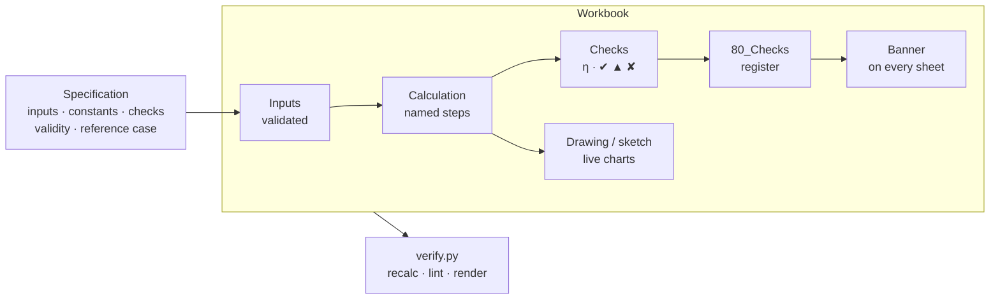

<div align="center">

# eng-calc-workbook

**An agent skill that builds engineering calculation workbooks in Excel —<br>checks you can trust, and part drawings that redraw themselves.**

[](https://github.com/Jinksen/eng-calc-workbook/actions/workflows/verify.yml)


<sub>One workbook, six sets of inputs: hole count, diameters, hub, fit and scale change — the section, hatching, dimensions with tolerances, view and title block follow. Every number is a formula.</sub>

</div>

---

## What it does

Ask Claude for a calculation, a design check or a part drawing in Excel and the skill makes
sure the result reads like a **hand calculation in a technical report**:

| | |
|---|---|
| 📐 **Calc pad layout** | title block → status banner → inputs → steps → checks → result; one quantity per row with symbol, unit, relation and source |
| ✅ **Checks with utilisation η** | every condition gets η and a status ✔ / ▲ / ✘; a banner on every sheet says whether the result may be used; a register collects all checks |
| 🛡️ **Guarded inputs** | data validation + a status cell that also catches pasted values; an input out of range turns the banner red |
| 🧭 **Traceability** | named ranges everywhere (`=calc_qEd*in_L^2/8`), constants only with a standard and clause, README with scope, assumptions and revision log |
| ✏️ **Live part drawings** | sections with hatching, dimensions with ISO 286 / ISO 2768 tolerances, GD&T frames, title block and automatic scale — all as charts driven by cells |
| 🖨️ **Printable report** | a report sheet that reads like a hand calculation: <i>symbol = relation = substituted values = result</i>, data tables, sketches, summary of checks, signatures |
| 📊 **Dashboards** | KPI tiles, live sketches, diagrams, utilisation chart; guidance for sliders, gauges, unit switches and flowcharts |
| 🔍 **Verification** | recalculation in LibreOffice, lint for magic numbers, missing validation and volatile functions, PDF / PNG render |

It works in three environments:

| Environment | How the skill works |
|---|---|
| **Claude in Excel** | live in the open workbook, native Excel only (formulas, styles, conditional formatting, validation, names, charts) |
| **claude.ai / Claude Code** | generates the `.xlsx` with the `engcalc.py` library and verifies it with LibreOffice |
| **Review / large workbooks** | a findings table by severity, or a split into tracer-bullet tickets |

## Gallery

<table>
<tr>
<td width="50%"><br><sub><b>Part drawing</b> — section A–A with live hatching, view B, dimensions with tolerances linked to cells, automatic scale 1:1</sub></td>
<td width="50%"><br><sub><b>Calc pad</b> — guarded inputs, constants with sources, ISO 286 fit lookup, every step with its relation</sub></td>
</tr>
<tr>
<td><br><sub><b>Check register</b> — every check and condition with η, status and a link back to its row</sub></td>
<td><br><sub><b>Overview</b> — KPI tiles, live section sketch, M(x) and w(x), utilisation chart (IPE beam, EN 1993-1-1)</sub></td>
</tr>
<tr>
<td><br><sub><b>Printable report</b> — identification, input box with sketch, key result panel, design status, steps <i>symbol = relation = substituted values = result</i></sub></td>
<td><br><sub><b>Report, page 2</b> — striped data table with a total row next to live charts, summary of checks, assumptions, signatures</sub></td>
</tr>
</table>

## How a workbook is built



| Sheet | Content |
|---|---|
| `00_README` | identification (`meta_*`), purpose, scope, assumptions, workflow, legend, contents, sources, revisions |
| `01_Overview` | banner, KPI tiles, drawing or sketch, diagrams, utilisation — references only |
| `1x_*` | calculation sheets (calc pad) |
| `2x_*` | drawings |
| `70_Report` | printable calculation report (style R) — reads only from the calculation |
| `80_Checks` | register of all checks, `cfg_eta_warn`, totals for the banner |
| `9x_*` | databases (Excel tables) and chart / drawing data |

## Installation

**claude.ai and Claude in Excel** — download `eng-calc-workbook.zip` from the
[releases](https://github.com/Jinksen/eng-calc-workbook/releases) (or zip the folder
`skills/eng-calc-workbook` yourself), then *Settings → Capabilities → Skills → Upload skill*
and enable it. Claude in Excel applies enabled skills automatically.

**Claude Code** (the repository is private — `git` needs access to GitHub, e.g. `gh auth login`):

```
/plugin install eng-calc-workbook --marketplace Jinksen/eng-calc-workbook
```

In older versions of Claude Code run `/plugin marketplace add Jinksen/eng-calc-workbook`
first, then `/plugin install eng-calc-workbook@eng-calc-workbook`. Or copy the skill folder
into `~/.claude/skills/`.

## Quick start

Just describe the task — the skill triggers on engineering workbooks:

> *Build a check of a simply supported IPE beam for a 6 m span, g_k = 6 kN/m, q_k = 5 kN/m.*

> *Make a workbook for this flange: Ø100, hub Ø44 × 26, bore Ø20 H7 on a g6 shaft, 4 holes Ø9 on Ø70. Draw it with tolerances.*

> *Review this cable sizing workbook and tell me what is wrong with it.*

Claude first writes a specification table (inputs with ranges, constants with sources,
checks, validity conditions, a reference case) for you to confirm, then builds, verifies and
reports a hand check of at least one result.

### Building the reference workbooks yourself

```bash
pip install openpyxl pillow matplotlib          # + LibreOffice and poppler-utils for verify
python skills/eng-calc-workbook/scripts/example_flange.py out/example_flange.xlsx
python skills/eng-calc-workbook/scripts/example_ipe_beam.py out/example_ipe_beam.xlsx
python skills/eng-calc-workbook/scripts/verify.py out/example_flange.xlsx --render out/render
```

```
BANNER: ✔ ALL CHECKS AND CONDITIONS SATISFIED     η max = 0,86
    0.82  ✔ OK                               Maximum clearance
    0.36  ✔ OK                               Minimum axial gap
    0.86  ✔ OK                               Edge distance
    …
errors=0 warnings=0 info=0
```

## The library in 25 lines

```python
import datetime as dt
from engcalc import EngWorkbook, Meta, Col, index_match

book = EngWorkbook(Meta(project="Drive unit", title="Shaft check", subject="Output shaft",
                        author="A. Engineer", date=dt.date.today(), domain="mechanical"))

db = book.data_sheet("90_Database", "Materials", "Material catalogue")
db.table("mat", [Col("key", "Material"), Col("Re", "Re [MPa]", "0")],
         [("C45", 430), ("42CrMo4", 650)], source="EN 10083-2, Tab. 4")
db.close()

s = book.calc_sheet("10_Shaft", "Shaft check", "Inputs, stress, check")
s.section("Inputs")
s.input("in_T", "Torque", "T", 250, "Nm", lo=1, hi=5000)
s.input("in_d", "Diameter", "d", 30, "mm", lo=10, hi=200)
s.input("in_mat", "Material", "", "C45", "", choices="lst_mat")
s.section("Check")
s.calc("calc_tau", "Torsional stress", "τ", "16*in_T*1000/(PI()*in_d^3)", "MPa", text="τ = 16 T / (π d³)")
s.calc("calc_Re", "Yield strength", "R_e", index_match("mat", "Re", "in_mat"), "MPa", fmt="0")
s.check("chk_tau", "Torsion", "η_τ", "calc_tau", "calc_Re/SQRT(3)/2", "MPa", source="safety 2 on τ_y")
s.close()

book.readme(purpose="…", scope=["…"], assumptions=["…"], workflow=["…"], sources=["…"], revisions=[])
book.save("out/shaft.xlsx")        # register, banner, legend, README, protection — automatic
```

Drawing toolkit: `drawing_chart()` + `DrawSeries` (ISO 128 line types, arrowed dimensions,
texts from cells), `DataSheet.hatch()`, `DrawingSheet.gdt_frame()` / `title_block()`,
`interval_lookup()` for ISO size ranges and `tol_text()` for tolerances — see
[`example_flange.py`](skills/eng-calc-workbook/scripts/example_flange.py) and
[`part-drawing.md`](skills/eng-calc-workbook/reference/part-drawing.md).

## Reference builds

| Build | Field | What it shows |
|---|---|---|
| [`example_flange.py`](skills/eng-calc-workbook/scripts/example_flange.py) | mechanical | ISO 286 fit H7/f6…p6, ISO 2768-1, worst-case + RSS tolerance chain, hole pattern and wall checks, mass, automatic scale, live section + view, GD&T, title block |
| [`example_ipe_beam.py`](skills/eng-calc-workbook/scripts/example_ipe_beam.py) | civil | EN 1993-1-1 section class, bending, shear, M+V, deflection; live section sketch, M(x), w(x); printable report `70_Report` |

Both build and pass `verify.py` with zero errors and zero lint warnings in CI.

## Repository layout

```
.claude-plugin/              plugin.json, marketplace.json
skills/eng-calc-workbook/
  SKILL.md                   the procedure: specification → skeleton → calc pad → conditions → graphics → verification
  reference/
    visual-language.md       colours, grid, title block, drawing line types (single source of truth)
    conditions.md            status formulas, register, banner, conditional formatting
    sheet-styles.md          style K (compact TCC-style sheet) and style P (calc pad)
    report-sheet.md          style R — printable calculation report with substituted values
    excel-toolbox.md         task → function → Excel version
    part-drawing.md          parametric drawings: outline, hatching, tolerances, GD&T, title block
    dashboard-widgets.md     controls, gauges, shapes, flowcharts
    domains.md               typical checks: electrical / mechanical / civil
    patterns.md              patterns P1–P28 from reference workbooks
    excel-in-place.md        path A — Claude in Excel / manual build
    python-engcalc.md        path B — library API and openpyxl pitfalls
    review.md · tickets.md · vba.md
  scripts/
    engcalc.py               the openpyxl builder
    example_flange.py        reference build: flange with drawing
    example_ipe_beam.py      reference build: IPE beam
    verify.py                LibreOffice recalculation + lint + render
docs/images/                 README screenshots
.scratch/eng-calc-workbook/issues/   roadmap as tracer-bullet tickets
.github/workflows/verify.yml         CI: build every example_*.py + verify
```

## Roadmap

Open tickets in [`.scratch/eng-calc-workbook/issues`](.scratch/eng-calc-workbook/issues):
live test in Claude in Excel · cable sizing (IEC 60364) · capacity envelope · bolt group ·
iteration in rows (Colebrook) · FDM grid · variants in columns · `verify --stress` ·
release assets · rolling bearing (ISO 281) · phasors · compact style K in the library.

## Contributing

See [CONTRIBUTING.md](CONTRIBUTING.md). In short: every new library capability needs a
reference build that uses it and passes `verify.py`, and every value from a standard needs
its source.

## License

[MIT](LICENSE) © 2026 eng-calc-workbook contributors

> Tolerance and material tables in the reference builds are excerpts for demonstration.
> Verify them against the current standards and catalogues before using a workbook for real work.
